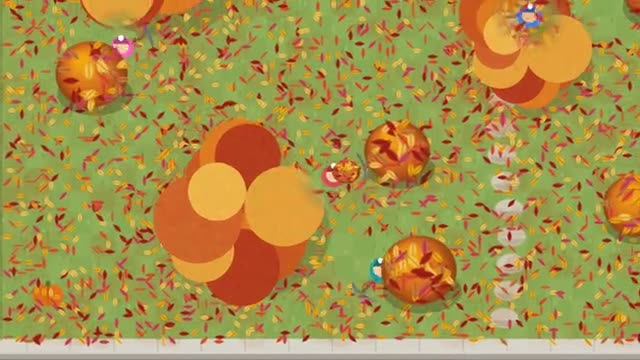

# Leaf Pile

Rake the biggest leaf pile. Then jump in it. A multiplayer starter game from [Multiplayer Agent](https://multiplayeragent.com): 2D, drop-in, 1–8 players, with bots that fill empty seats.

## How it plays

Hold to rake leaves into your arms and let go to drop them on a pile; bag big piles for coins before a gust blows the small ones apart. The trees keep shedding all afternoon, and a pile of 60 or more is begging for a jump.

**Controls:** Hold the mouse to walk and rake (or WASD + hold Space), let go to drop, E bags, Q jumps in, B blower; touch: drag to walk, hold RAKE, BAG and JUMP by a pile.

## Make it yours in the Game Builder

Open the [Game Builder](https://multiplayeragent.com), choose **Start from a starter game** and pick Leaf Pile. It opens as version 1 in your studio, ready to play and publish. Then ask for changes, for example:

- Add a squirrel that steals leaves from the biggest pile
- Make it a beach, raking seaweed into piles
- Let players trade coins for a bigger rake

## Run it yourself

1. Get a free publishable key (`pk_…`) at [multiplayeragent.com](https://multiplayeragent.com).
2. In `index.html`, put it in place of `pk_REPLACE_ME` in the `MP_CONNECT` block.
3. Open `index.html` in a browser. No build step and no server needed.

Without a key it still runs, offline against bots.

## How it is built

- One `index.html`. The comment at the top of the script maps the code and explains the multiplayer.
- **Host-run rules:** The host's browser keeps every leaf and pile, runs the clock, the falling leaves and the gusts; if it leaves, the next player takes over.
- **Live sync:** Everyone rakes the same yard: your own raking shows at once and lands for everyone a moment later.
- **Bots:** Bot neighbors rake leaves to their own piles and bag them until enough people join.
- **Leaderboard:** The most coins each player made in one afternoon.
- **Live ops:** Make every wave of falling leaves bigger or smaller with no new deploy.
- `?attract` runs it offline with bots only. The preview video is recorded from it.

## License

MIT.
